# GigCessHQ — System Architecture & Implementation Reference

## 1. Architectural Overview

GigCessHQ is a compliance automation platform for gig economy aggregators under the **Code on Social Security, 2020 (Act No. 36 of 2020)** and the **Digital Personal Data Protection (DPDP) Act, 2023**.

```mermaid
graph TD
    Client["Aggregator Compliance Officer / Admin / CA Partner"] --> NextApp["Next.js 16 App Router (Port 3000)"]

    subgraph Frontend["Presentation Layer (app/src/app)"]
        Landing["Landing Page (/)"]
        AuthUI["Auth Pages (/login, /register)"]
        DashLayout["Dashboard Shell — live org/user/deadline (/dashboard)"]
        OverviewUI["Compliance Overview (/dashboard)"]
        WorkerUI["Worker Directory + activity modal (/dashboard/workers)"]
        UploadUI["CSV Ingestion Studio (/dashboard/upload)"]
        EngineUI["Eligibility Engine (/dashboard/eligibility)"]
        FilingsUI["Statutory Filings Wizard (/dashboard/filings)"]
        CalcUI["Section 114 Simulator (/dashboard/calculator)"]
        ChallanUI["Challan Vault (/dashboard/challans)"]
        AlertsUI["Alerts & Notifications (/dashboard/alerts)"]
        ReportsUI["Audit Dossier Exporter (/dashboard/reports)"]
        SettingsUI["Organization Settings (/dashboard/settings)"]
        PartnerUI["Advisory Partner Portal (/partner)"]
        FreeAuditUI["Public Free Risk Audit (/free-audit)"]
    end

    NextApp --> Frontend
    NextApp --> API["REST API Layer (/api/v1/*) — 19 route files"]

    subgraph CoreLibs["Core Computational Layer (app/src/lib)"]
        AuthLib["auth.ts (registration validators only)"]
        SessionLib["session.ts (auth.users → profiles → organizations)"]
        DataAccess["data-access.ts (requireTenant + RLS mappers)"]
        MaskingLib["aadhaar-masking.ts (last-4 pipeline)"]
        ContribCalc["contribution-calc.ts (Section 114 Formula)"]
        EligEngine["eligibility-engine.ts (75/90/120 Engine + ranks)"]
        PenaltyCalc["penalty-calc.ts (Section 133 1%/mo simple)"]
        FYLib["financial-year.ts (Indian FY helpers)"]
        CsvParser["csv-parser.ts (PapaParse Batch Validator)"]
        AuditLogger["audit-logger.ts (append-only event log)"]
        SupaLib["supabase/ (browser / server / service clients)"]
        TypesLib["types.ts (WorkerRecord, FilingItem, …)"]
    end

    API --> CoreLibs
    CoreLibs --> Supabase["Supabase Postgres + Auth + RLS"]
```



Auth is Supabase cookie sessions (no local JWT service). There is no Prisma/data-store/encryption module, no email service, no PDF generator, no XLSX support.

---

## 2. Directory Structure

```
freelance-wali-platform/
├── README.md                              ← Master documentation index
├── prd.md                                 ← Product Requirements Document (mirror of docs/prd.md)
├── tech_spec_and_db_schema.md             ← Technical spec & SQL schema (mirror)
├── docs/                                  ← Comprehensive Documentation Suite
│   ├── ai_slop_review.md                  ← Code-quality review + remediation log
│   ├── api_specification.md               ← 19 REST API endpoints, as-built
│   ├── api_testing_guide.md               ← Curl & PowerShell testing commands
│   ├── compliance_officer_guide.md        ← Step-by-step user manual
│   ├── environment_setup.md               ← Developer guide & deployment specs
│   ├── glossary.md                        ← Statutory & technical terms
│   ├── operations_runbook.md              ← Operations, migrations & maintenance
│   ├── regulatory_reference.md            ← Legal mapping to Code on Social Security 2020
│   ├── security_policy.md                 ← Supabase Auth, RLS & DPDP posture (as-built)
│   ├── system_architecture.md             ← This architectural reference
│   ├── tech_spec_and_db_schema.md         ← Engines, privacy, SQL schema
│   ├── user_flows.md                      ← User journeys, as-built
│   └── csv_templates/
│       ├── daily_ledger_template.csv      ← Canonical daily engagement headers
│       └── summary_backfill_template.csv  ← Canonical backfill headers
└── app/                                   ← Production Next.js Application
    ├── package.json                       ← Dependencies & build scripts
    ├── next.config.ts                     ← Next.js configuration
    ├── tsconfig.json                      ← Strict TypeScript configuration
    ├── postcss.config.mjs                 ← PostCSS / TailwindCSS v4 plugin
    ├── .env.example                       ← Supabase keys + CRON_SECRET template
    ├── supabase/
    │   ├── migrations/                    ← 0001_init, 0002_address, 0003_leads
    │   └── seed.sql                       ← Idempotent demo dataset
    ├── scripts/
    │   └── seed-demo-user.mjs             ← Demo login user (service role)
    └── src/
        ├── proxy.ts                       ← Session refresh + page guards (Next 16 proxy())
        ├── lib/                           ← Engines + Supabase clients (see graph)
        └── app/                           ← Next.js 16 App Router views & APIs
            ├── globals.css                ← Tailwind v4 design tokens & utilities
            ├── layout.tsx                 ← Root layout (next/font)
            ├── page.tsx                   ← Landing page
            ├── login/page.tsx             ← Supabase browser sign-in
            ├── register/page.tsx          ← → POST /api/v1/auth/register
            ├── partner/page.tsx           ← Multi-client console (live KPIs)
            ├── free-audit/page.tsx        ← Public estimator funnel
            ├── dashboard/
            │   ├── layout.tsx             ← Live org/user/deadline shell
            │   ├── page.tsx               ← Overview: stats, deadline, recent filings
            │   ├── workers/page.tsx       ← Directory, add-worker, activity modal
            │   ├── upload/page.tsx        ← CSV Ingestion Studio
            │   ├── eligibility/page.tsx   ← Meters, cron trigger, declarations
            │   ├── filings/page.tsx       ← 4-step Form-XX wizard + table
            │   ├── calculator/page.tsx    ← Section 114 simulator
            │   ├── challans/page.tsx      ← Deposit form + locked vault
            │   ├── alerts/page.tsx        ← Notifications + mark-all-read
            │   ├── reports/page.tsx       ← Live audit dossier + CSV + print
            │   └── settings/page.tsx      ← Org save (PATCH) + real team list
            └── api/v1/                    ← 19 REST API route files
                ├── auth/{register,me}/route.ts
                ├── organizations/route.ts
                ├── team/route.ts
                ├── dashboard/{overview,eligibility}/route.ts
                ├── workers/route.ts
                ├── workers/[id]/route.ts
                ├── workers/[id]/declarations/route.ts
                ├── ledger/upload/route.ts
                ├── filings/route.ts
                ├── filings/[id]/route.ts
                ├── filings/[id]/challan/route.ts
                ├── notifications/route.ts
                ├── exports/workers/route.ts
                ├── exports/audit-report/route.ts
                ├── partner/clients/route.ts
                ├── free-audit/route.ts
                └── cron/evaluate-eligibility/route.ts
```

---

## 3. Core Engine Mechanics

### 3.1 Section 114 Contribution Calculator
Statutory mandate: Aggregators must deposit a social security cess between 1% and 2% of annual turnover, but capped at 5% of aggregate payments to gig workers.

$$\text{Turnover Cess} = \text{Annual Turnover} \times \text{Category Rate (default 1.5\%)}$$
$$\text{Payout Cap} = \text{Aggregate Worker Payouts} \times 5.0\%$$
$$\text{Final Statutory Obligation} = \min(\text{Turnover Cess}, \text{Payout Cap})$$

- Pure function in `src/lib/contribution-calc.ts`, used by filings POST, free-audit, and the dashboard simulator.
- Rates are hardcoded (no config table, no gazette-driven updates).

### 3.2 Rule 28 Worker Eligibility Engine
Single source of truth (`src/lib/eligibility-engine.ts`); the cron syncs both ways, ingestion/declarations promote only:

1. **Criterion A (Single Platform):** `internalDays ≥ 90` → `ELIGIBLE`, where the cron evaluates `max(rolling-90-day distinct count, FY internal days)`.
2. **Criterion B (Multi-App Aggregation):** `internal + external ≥ 120` **and** `external > 0` → `ELIGIBLE_MULTI_AGGREGATOR` (directory UI folds this into `ELIGIBLE`).
3. **Warning Zone:** `internalDays ≥ 75` → `APPROACHING`; otherwise `INACTIVE`. There is no 85-day tier.

### 3.3 Aadhaar Masking Pipeline (DPDP Act 2023)
- Raw 12-digit Aadhaar numbers must **never** be stored or rendered.
- Worker creation validates `^[2-9]\d{11}$` and persists only `XXXX-XXXX-1234`; CSV ingestion keeps the last 4 characters.
- Only the masked form appears in UI, exports, and audit data. Implemented in `src/lib/aadhaar-masking.ts` + `src/lib/csv-parser.ts`.
- Phones are stored **plaintext** (`phone_encrypted` is a legacy column name) — the known, documented gap.

### 3.4 Section 133 Late Payment Penalty
- Delay beyond a statutory due date triggers:
  $$\text{Interest} = \text{Unpaid Cess} \times 1\% \times \lceil\text{Months Overdue}\rceil$$
- Simple interest, 12% per annum; statutory damages up to 100% are displayed as context in the simulator (not computed as liability).
- The calculator's penalty tab is explicitly illustrative (hypothetical due date), not a live filing assessment.

### 3.5 Challan Vault & Immutable Audit Lock (Rule 32)
- The officer picks an open filing and submits challan number + UTR (bank/amount/date optional with server defaults).
- The system hashes `challan:utr:amount:date:timestamp` (SHA-256), flips the filing to `PAID`, and logs the lock.
- PAID filings reject `PATCH` with `409 FILING_LOCKED`; the lock is enforced by code + append-only audit policy (no UPDATE/DELETE RLS policies on `audit_logs`).
