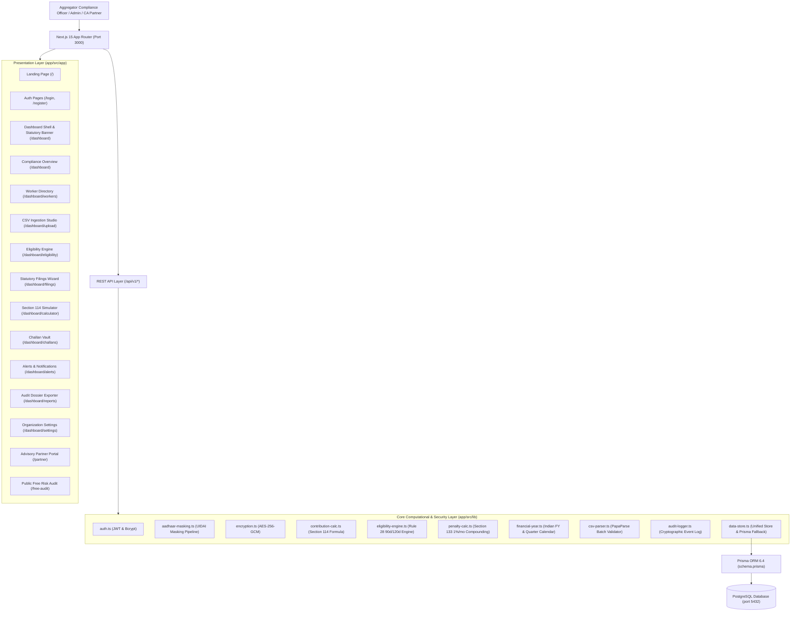

# GigCessHQ — System Architecture & Implementation Reference

## 1. Architectural Overview

GigCessHQ is built as an enterprise-grade compliance automation platform for gig economy aggregators under the **Code on Social Security, 2020 (Act No. 36 of 2020)** and the **Digital Personal Data Protection (DPDP) Act, 2023**.



---

## 2. Directory Structure

```
c:/Users/admin/Desktop/work/freelance wali platform/
├── README.md                              ← Master documentation index
├── prd.md                                 ← Product Requirements Document
├── tech_spec_and_db_schema.md             ← Technical spec & Prisma models
├── docs/                                  ← Comprehensive Documentation Suite
│   ├── api_specification.md               ← 40+ REST API endpoints specification
│   ├── user_flows.md                      ← 14 Mermaid user journeys
│   ├── regulatory_reference.md            ← Legal mapping to Code on Social Security 2020
│   ├── environment_setup.md               ← Developer guide & deployment specs
│   ├── security_policy.md                 ← DPDP Act & AES-256-GCM security specs
│   ├── glossary.md                        ← 50+ statutory & technical terms
│   ├── system_architecture.md             ← This architectural reference
│   ├── api_testing_guide.md               ← Curl & PowerShell testing commands
│   ├── compliance_officer_guide.md        ← Step-by-step user manual
│   ├── operations_runbook.md              ← Operations, migrations & maintenance
│   └── csv_templates/
│       ├── daily_ledger_template.csv      ← Sample daily engagement logs
│       └── summary_backfill_template.csv  ← Sample quarterly backfill logs
└── app/                                   ← Production Next.js Application
    ├── package.json                       ← Dependencies & build scripts
    ├── next.config.ts                     ← Next.js configuration
    ├── tsconfig.json                      ← Strict TypeScript configuration
    ├── postcss.config.mjs                 ← PostCSS / TailwindCSS v4 plugin
    ├── .env                               ← Environment variables
    ├── prisma/
    │   └── schema.prisma                  ← 12 Prisma models & 6 enums
    └── src/
        ├── lib/                           ← Core computational & security engines
        │   ├── aadhaar-masking.ts         ← UIDAI regex masking pipeline
        │   ├── auth.ts                    ← JWT session verification & passwords
        │   ├── contribution-calc.ts       ← Section 114 cess & 5% cap comparison
        │   ├── eligibility-engine.ts      ← 90-day rolling & 120-day cumulative engine
        │   ├── encryption.ts              ← AES-256-GCM field encryption
        │   ├── financial-year.ts          ← April–March financial year utilities
        │   ├── penalty-calc.ts            ← Section 133 simple interest compounding
        │   ├── audit-logger.ts            ← Cryptographic audit trail logger
        │   ├── csv-parser.ts              ← PapaParse CSV validation
        │   ├── data-store.ts              ← Unified data store & seed repository
        │   └── db.ts                      ← PrismaClient singleton
        └── app/                           ← Next.js 15 App Router views & APIs
            ├── globals.css                ← Tailwind CSS design tokens & utilities
            ├── layout.tsx                 ← Root HTML layout & font definitions
            ├── page.tsx                   ← Dark-mode landing page
            ├── login/page.tsx             ← Authentication interface
            ├── register/page.tsx          ← Aggregator onboarding
            ├── partner/page.tsx           ← Multi-client CA advisory portal
            ├── free-audit/page.tsx        ← Public lead-gen compliance risk audit
            ├── dashboard/
            │   ├── layout.tsx             ← Statutory banner & navigation shell
            │   ├── page.tsx               ← Main compliance overview dashboard
            │   ├── workers/page.tsx       ← Worker directory with masked Aadhaar
            │   ├── upload/page.tsx        ← CSV Ingestion Studio
            │   ├── eligibility/page.tsx   ← 90/120-day eligibility engine
            │   ├── filings/page.tsx       ← 4-step Form-XX filing wizard
            │   ├── calculator/page.tsx    ← Interactive Section 114 simulator
            │   ├── challans/page.tsx      ← Challan Vault & SHA-256 lock
            │   ├── alerts/page.tsx        ← Statutory notifications center
            │   ├── reports/page.tsx       ← Rule 32 certified audit dossier
            │   └── settings/page.tsx      ← Organization & team RBAC settings
            └── api/v1/                    ← 20 REST API route handlers
                ├── auth/login/route.ts
                ├── auth/register/route.ts
                ├── auth/me/route.ts
                ├── dashboard/overview/route.ts
                ├── dashboard/eligibility/route.ts
                ├── workers/route.ts
                ├── workers/[id]/route.ts
                ├── workers/[id]/declarations/route.ts
                ├── ledger/route.ts
                ├── ledger/upload/route.ts
                ├── filings/route.ts
                ├── filings/[id]/route.ts
                ├── filings/[id]/challan/route.ts
                ├── contributions/calculate/route.ts
                ├── contributions/penalties/route.ts
                ├── notifications/route.ts
                ├── exports/workers/route.ts
                ├── exports/audit-report/route.ts
                ├── partner/clients/route.ts
                ├── free-audit/route.ts
                └── cron/evaluate-eligibility/route.ts
```

---

## 3. Core Engine Mechanics

### 3.1 Section 114 Contribution Calculator
Statutory mandate: Aggregators must deposit a social security cess between 1% and 2% of annual turnover, but capped at 5% of aggregate payments to gig workers.

$$\text{Turnover Cess} = \text{Annual Turnover} \times \text{Category Rate (e.g. 1.5\%)}$$
$$\text{Payout Cap} = \text{Aggregate Worker Payouts} \times 5.0\%$$
$$\text{Final Statutory Obligation} = \min(\text{Turnover Cess}, \text{Payout Cap})$$

- If $\text{Payout Cap} < \text{Turnover Cess}$, the ceiling is applied and the aggregator saves the difference.
- Verified in `src/lib/contribution-calc.ts` and interactive in `/dashboard/calculator`.

### 3.2 Rule 28 Worker Eligibility Engine
A worker qualifies for social security welfare coverage when:
1. **Criterion A (Single Platform):** Worker has completed $\ge 90$ engagement days in the preceding 12-month rolling window with the reporting aggregator.
2. **Criterion B (Multi-App Aggregation):** Worker has completed $\ge 120$ cumulative days in the current Financial Year across one or more aggregators, supported by a self-declaration under Rule 28(2).
3. **Threshold Warning Zone:** Workers with $80 \le \text{days} < 90$ are flagged as `APPROACHING` so compliance officers can verify their e-Shram UAN linkage before coverage triggers.

### 3.3 Aadhaar Masking Pipeline (DPDP Act 2023)
- Under Section 4 of the Aadhaar Act and DPDP Act 2023 guidelines, raw 12-digit Aadhaar numbers must **never** be stored in plain text or rendered on screens.
- Any input matching `/^[2-9]\d{11}$/` is immediately stripped of the first 8 digits and converted to `XXXX-XXXX-1234`.
- The last 4 digits (`aadhaarLast4`) are stored alongside a SHA-256 HMAC for de-duplication searches.
- Implemented in `src/lib/aadhaar-masking.ts`.

### 3.4 Section 133 Late Payment Penalty Compounding
- Delay beyond statutory deadlines (e.g. October 31 for Form-XX Q2) triggers:
  $$\text{Interest} = \text{Unpaid Cess} \times 1\% \times \text{Months Overdue (fractions rounded up)}$$
- Simple interest rate: 12% per annum.
- Statutory damages: Up to 100% of the unpaid cess balance can be levied by the Social Security Officer under Section 133.

### 3.5 Challan Vault & Immutable Audit Lock (Rule 32)
- Upon bank deposit, the compliance officer inputs the Treasury Challan reference number, bank branch, and UTR number.
- The system generates an SHA-256 cryptographic hash of the submission payload:
  $$\text{SHA-256}(\text{ChallanNo} + \text{UTR} + \text{Amount} + \text{PaymentDate} + \text{Timestamp})$$
- The return status flips to `PAID` and becomes immutable, preventing accidental alterations before regulatory inspections.
