# User Flows & Journey Maps
## Gig Worker Social Security Compliance Platform

**Version:** 2.0
**Date:** 12 September 2026

> As-built flows. No email, no PDFs, no XLSX, no invite/impersonation flows exist. Where the UI shows a button that goes nowhere, the flow says so.

---

## Table of Contents

1. [Flow 1 — New Aggregator Onboarding](#flow-1--new-aggregator-onboarding)
2. [Flow 2 — Worker Roster Upload (Daily Ledger)](#flow-2--worker-roster-upload-daily-ledger)
3. [Flow 3 — Worker Roster Upload (Historical Backfill)](#flow-3--worker-roster-upload-historical-backfill)
4. [Flow 4 — Eligibility Dashboard & Day-Count Monitoring](#flow-4--eligibility-dashboard--day-count-monitoring)
5. [Flow 5 — Worker Self-Declaration (Cross-Platform Days)](#flow-5--worker-self-declaration-cross-platform-days)
6. [Flow 6 — Form-XX Filing Wizard (Quarterly)](#flow-6--form-xx-filing-wizard-quarterly)
7. [Flow 7 — Annual Filing (Form-XXI — API only)](#flow-7--annual-filing-form-xxi--api-only)
8. [Flow 8 — Challan Deposit & Audit Lock](#flow-8--challan-deposit--audit-lock)
9. [Flow 9 — Free Compliance Audit (Lead Funnel)](#flow-9--free-compliance-audit-lead-funnel)
10. [Flow 10 — Law Firm Partner Portal](#flow-10--law-firm-partner-portal)
11. [Flow 11 — Compliance Audit Export](#flow-11--compliance-audit-export)
12. [Flow 12 — Deadline Alerts & Nightly Sync](#flow-12--deadline-alerts--nightly-sync)
13. [Flow 13 — Team Management (Read-Only)](#flow-13--team-management-read-only)
14. [Flow 14 — Contribution Calculation & Comparison](#flow-14--contribution-calculation--comparison)

---

## Flow 1 — New Aggregator Onboarding

**Persona:** Founder / Ops Lead
**Entry Point:** Landing page → "Get Started" CTA

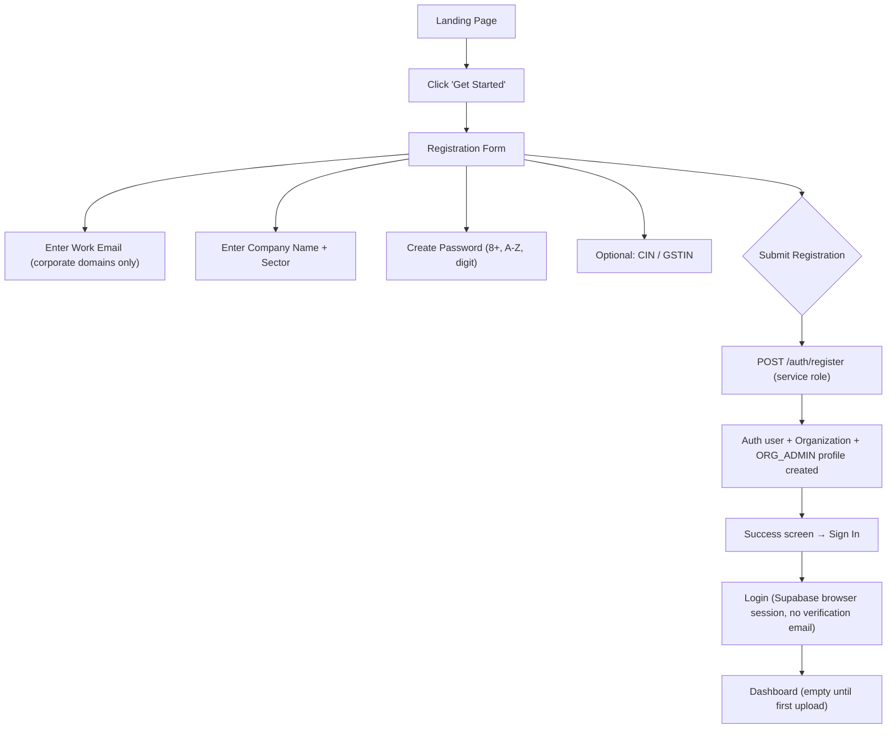

**Key Screens:**
1. **Registration Form** — Work email, company name, sector dropdown, password, optional CIN/GSTIN.
2. **Account Created** — Inline success card linking to `/login`.
3. **Dashboard Empty State** — Zero-stats and empty tables until data is ingested.

**Validation Rules:**
- Work email: blocks gmail, yahoo, outlook, hotmail, aol, icloud, mail, protonmail, yandex, rediffmail.
- Password: min 8 chars, 1 uppercase, 1 digit.
- Sector: must be a valid enum value.

**Audit Events:** none on this path (registration writes are service-role inserts, not audit-logged).

---

## Flow 2 — Worker Roster Upload (Daily Ledger)

**Persona:** Ops Lead / Finance Lead
**Entry Point:** Dashboard → CSV Ingestion Studio → "Daily Engagement Ledger"

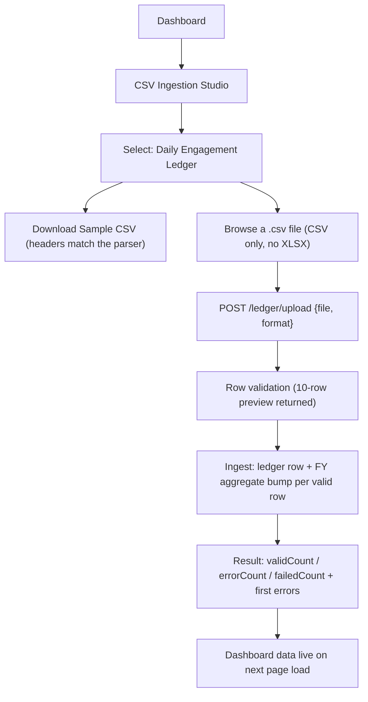

**CSV Column Mapping (only these are read):**

| Expected Header | Aliases Accepted | Required |
|---|---|---|
| `worker_id` | — | ✅ |
| `worker_name` | — | ✅ |
| `uan` | `UAN` | ❌ |
| `aadhaar_last4` | `aadhaar`, `Aadhaar` | ❌ (last 4 kept, `0000` fallback) |
| `date` | `engagement_date`, `Date` | ✅ valid date |
| `hours_worked` | `hours` | 0–24 |
| `gross_payout` | `payout` | ≥ 0 (negative is an error) |
| `platform_turnover_attributed` | `turnover` | ❌ |
| `trip_or_gig_count` | `trips` | ❌ (default 1) |

**Error Handling:**
- Invalid rows are listed with row number + reason; valid rows still ingest.
- Re-uploads conflict on `(worker, date, trip)` and surface as `failedCount`, not silent duplicates.
- Unknown `worker_id` auto-creates an `INACTIVE` worker. Eligibility updates are promote-only.

---

## Flow 3 — Worker Roster Upload (Historical Backfill)

**Persona:** Ops Lead
**Entry Point:** Dashboard → CSV Ingestion Studio → "Quarterly Summary Backfill"

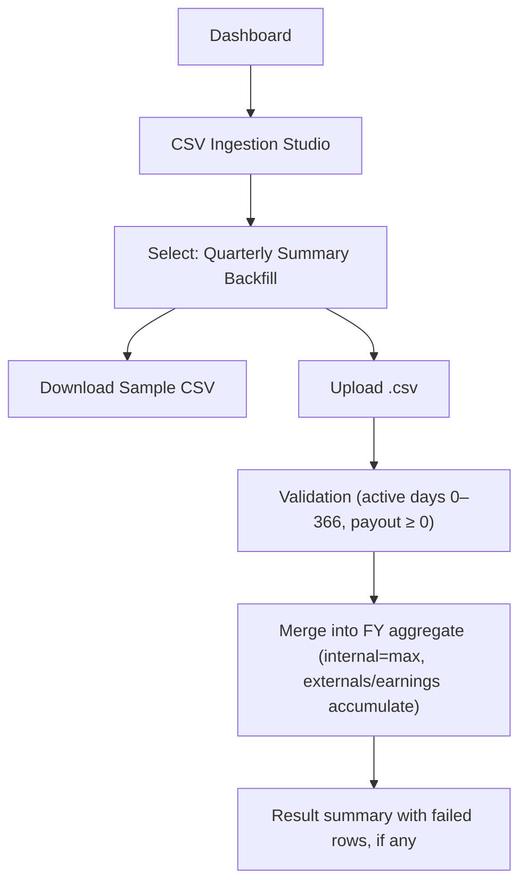

**Columns:** `worker_id, worker_name, uan, aadhaar_last4, period_start, period_end, total_active_days, total_payout, other_platform_days` — anything else is ignored (notably there is **no** provenance/tag column and no dry-run mode).

**Important Distinctions from Daily Ledger:**
- No individual engagement day entries are created — only aggregate records.
- External days carry no stored provenance tag.
- Intended for rapid initial onboarding; ongoing tracking uses the Daily Ledger.

---

## Flow 4 — Eligibility Dashboard & Day-Count Monitoring

**Persona:** Ops Lead
**Entry Point:** `/dashboard/eligibility` (meters) + `/dashboard` (overview)

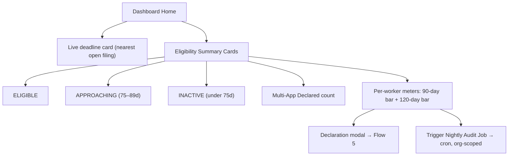

**Dashboard Components:**

| Component | Data Shown | Update Frequency |
|---|---|---|
| **Deadline card** | Nearest open filing, days left, recent filings | On page load |
| **Eligibility cards** | Worker counts by tier | On page load |
| **Worker meters** | 90-day + cumulative progress per worker | On page load |
| **Alerts center** | In-app notifications, mark-all-read | On page load |

There are no projected-eligibility dates, no earnings charts, and no worker-detail page — the worker profile is a modal with a 30-day activity strip.

---

## Flow 5 — Worker Self-Declaration (Cross-Platform Days)

**Persona:** Ops Lead (on behalf of worker)
**Entry Point:** Eligibility page → per-worker "Add Multi-App Days"

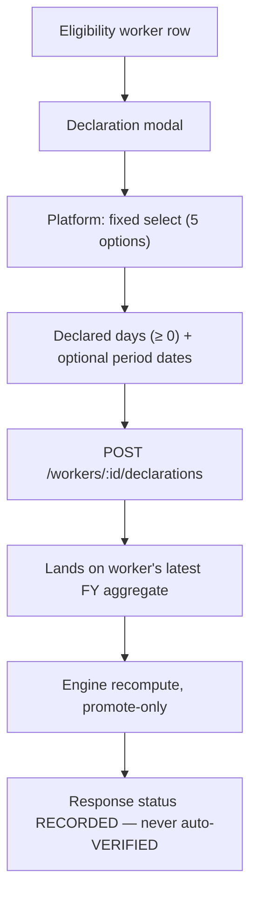

- No file upload, no confirmation dialog, no Verified/Self-Reported badges in UI (only the `+Nd Multi-App` chip in the directory).
- `periodStart/End` are echoed in the response, not stored (no such columns).
- A declaration can promote to `ELIGIBLE`/`ELIGIBLE_MULTI_AGGREGATOR` but never demotes.

---

## Flow 6 — Form-XX Filing Wizard (Quarterly)

**Persona:** Finance Lead / Ops Lead
**Entry Point:** `/dashboard/filings` → "New Form-XX Filing"

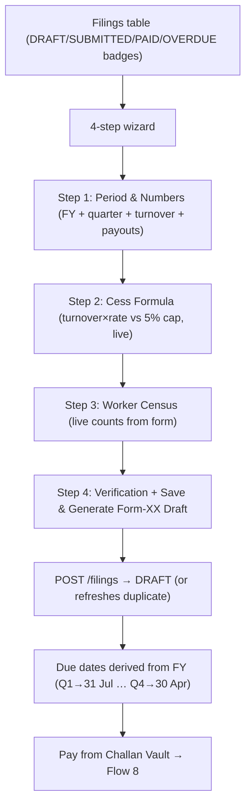

No org-details step, no PDF preview/download, no Form-XXI wizard in the UI (the API accepts `FORM_XXI_ANNUAL`, due 30 Jun end-year).

---

## Flow 7 — Annual Filing (Form-XXI — API only)

There is **no Form-XXI wizard** in the UI. Annual returns are created via `POST /filings` with `filingType: "FORM_XXI_ANNUAL"` (quarter null, due 30 Jun of the end year) and paid/locked through the same challan flow. No balance-payable netting or overdue wizard warnings exist.

---

## Flow 8 — Challan Deposit & Audit Lock

**Persona:** Finance Lead
**Entry Point:** Challan Vault → "Deposit Challan & Lock" (filing dropdown lists real open filings)

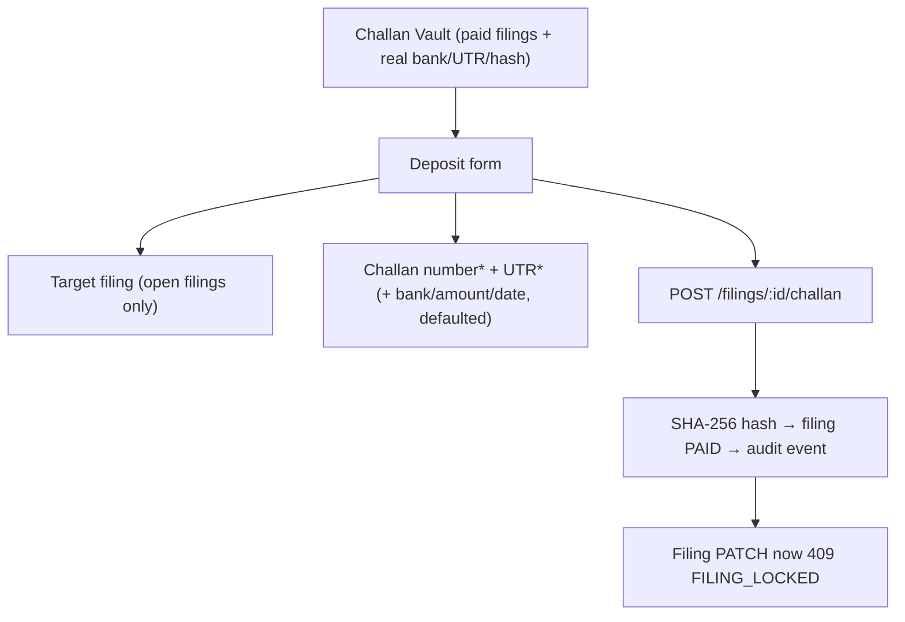

No CIN/BSR/receipt fields, no file upload (`document_url` stays null), no reconciliation check, no confirmation dialog — the lock is immediate and permanent.

---

## Flow 9 — Free Compliance Audit (Lead Funnel)

**Persona:** First-time Visitor / Prospective Customer
**Entry Point:** Landing page → "Free Compliance Check" CTA

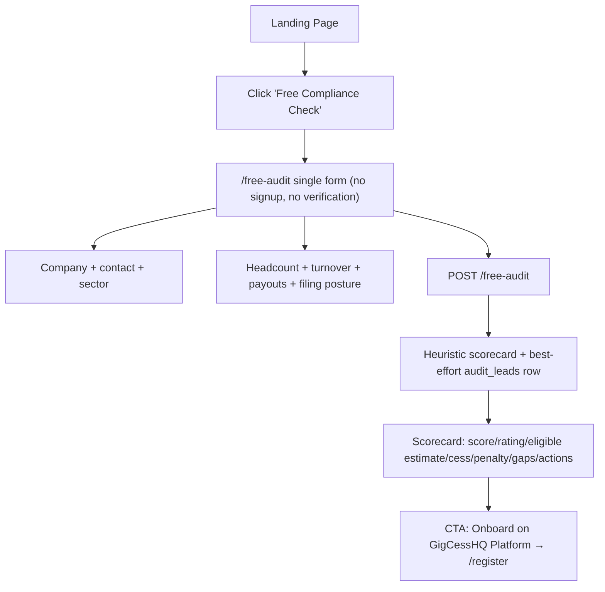

No CSV upload, no 500-row sample, no PDF report, no pricing page, no `funnel_*` analytics events. The estimator constants (85/−35/−15/0.76/0.12) are documented estimates, not statutory math.

---

## Flow 10 — Law Firm Partner Portal

**Persona:** Employment Law Firm / Compliance Advisory
**Entry Point:** `/partner` (same login session)

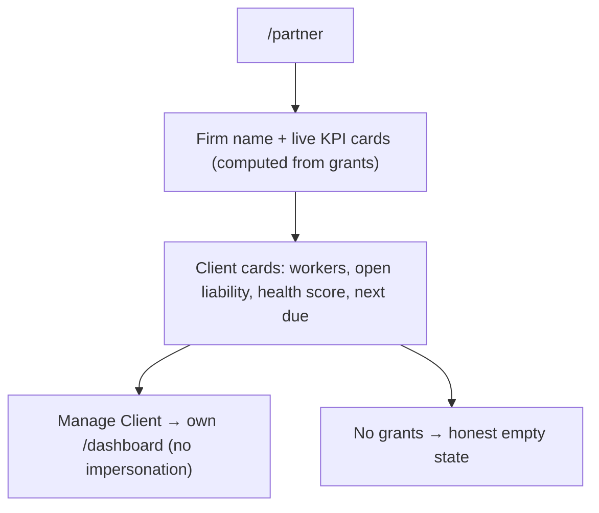

- `access_level` is read, never enforced. There is no context switch, no grant/revoke UI or API, no Settings → Partner Access page — grants are managed directly in `partner_client_access`.
- No unified deadline calendar, no bulk-report download, no client reminders.

---

## Flow 11 — Compliance Audit Export

**Persona:** Ops Lead / Finance Lead / External Advisor
**Entry Point:** Reports page → "Workers CSV" / "Print Dossier"

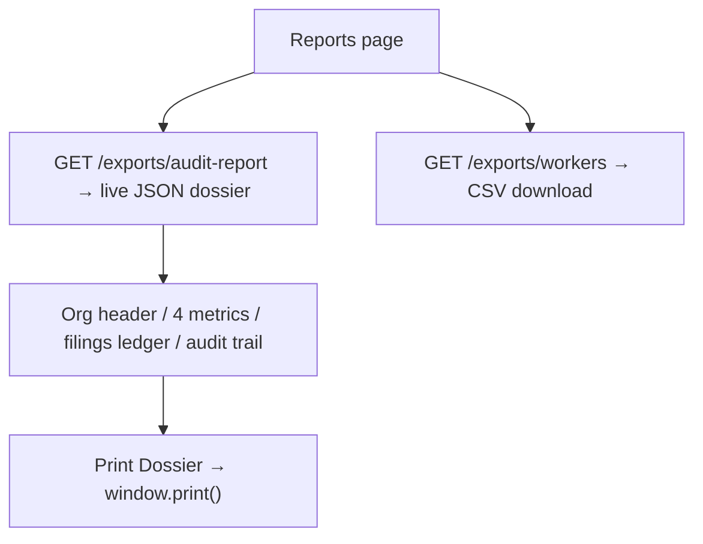

No report configuration, no Puppeteer PDF, no expiring links, no digests, no BSR/CIN/seal sections, no standalone audit-log query endpoint (last 20 rows ride inside the dossier).

---

## Flow 12 — Deadline Alerts & Nightly Sync

**Persona:** System → Ops Lead
**Trigger:** External scheduler → `POST /cron/evaluate-eligibility` (or the dashboard button, org-scoped)

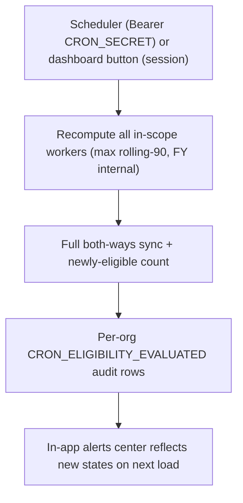

No email is sent (no mail provider), no 60/30/15/7/3/1 schedule exists, no penalty accrual runs, no Monday digest. In-app alerts are read/marked-read via `GET/PATCH /notifications`.

---

## Flow 13 — Team Management (Read-Only)

**Persona:** Org Admin
**Entry Point:** Settings → Compliance Team

The panel lists real `profiles` rows for the organization (`GET /team`). There is **no Invite button, no invitation email, no role editor, and no permission matrix enforcement** — membership is created at registration only. The settings form itself (name/sector/CIN/GSTIN/address) does persist via `PATCH /organizations`.

---

## Flow 14 — Contribution Calculation & Comparison

**Persona:** Finance Lead / Ops Lead
**Entry Point:** Dashboard → Section 114 Simulator (client-side; no API call)

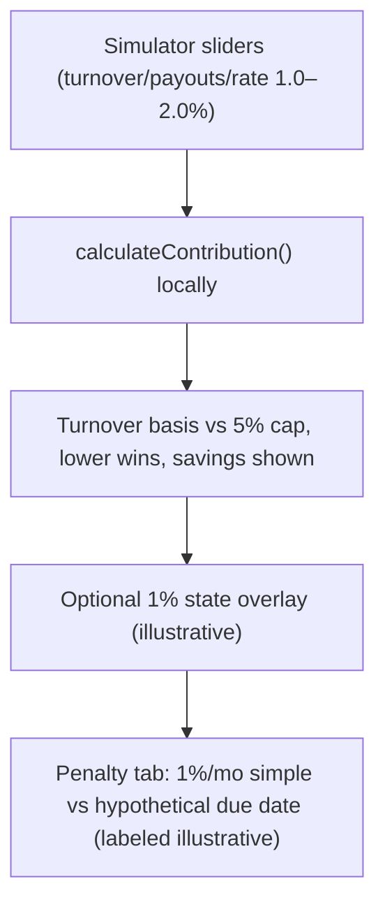

Defaults (₹40 Cr / ₹22 Cr / 1.5%) are starting slider positions, not org data. Rates are hardcoded — there is no rate-config table, gazette tracker, CONFIRMED/PENDING flow, or webhook/API ingestion.
