# User Flows & Journey Maps
## Gig Worker Social Security Compliance Platform

**Version:** 1.0  
**Date:** 12 September 2026

---

## Table of Contents

1. [Flow 1 — New Aggregator Onboarding](#flow-1--new-aggregator-onboarding)
2. [Flow 2 — Worker Roster Upload (Daily Ledger)](#flow-2--worker-roster-upload-daily-ledger)
3. [Flow 3 — Worker Roster Upload (Historical Backfill)](#flow-3--worker-roster-upload-historical-backfill)
4. [Flow 4 — Eligibility Dashboard & Day-Count Monitoring](#flow-4--eligibility-dashboard--day-count-monitoring)
5. [Flow 5 — Worker Self-Declaration (Cross-Platform Days)](#flow-5--worker-self-declaration-cross-platform-days)
6. [Flow 6 — Form-XX Provisional Filing Wizard](#flow-6--form-xx-provisional-filing-wizard)
7. [Flow 7 — Form-XXI Final Return Filing Wizard](#flow-7--form-xxi-final-return-filing-wizard)
8. [Flow 8 — Challan Upload & Audit Lock](#flow-8--challan-upload--audit-lock)
9. [Flow 9 — Free Compliance Audit (Lead-Gen Funnel)](#flow-9--free-compliance-audit-lead-gen-funnel)
10. [Flow 10 — Law Firm Partner Portal](#flow-10--law-firm-partner-portal)
11. [Flow 11 — Compliance Audit Export](#flow-11--compliance-audit-export)
12. [Flow 12 — Deadline Alert Lifecycle](#flow-12--deadline-alert-lifecycle)
13. [Flow 13 — Team Member Invitation](#flow-13--team-member-invitation)
14. [Flow 14 — Contribution Calculation & Comparison](#flow-14--contribution-calculation--comparison)

---

## Flow 1 — New Aggregator Onboarding

**Persona:** Founder / Ops Lead  
**Entry Point:** Landing page → "Get Started" CTA

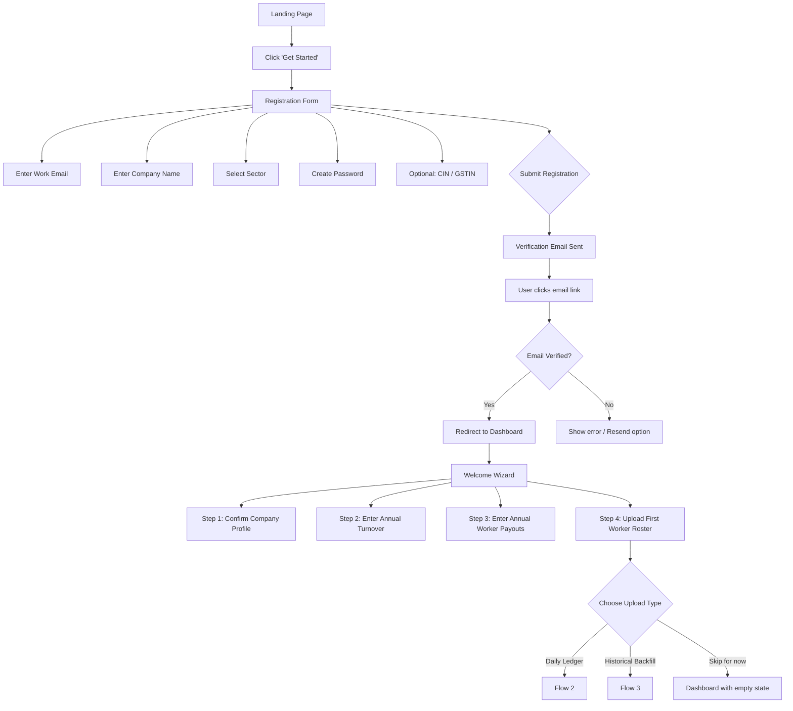

**Key Screens:**
1. **Registration Form** — Work email, company name, sector dropdown, password, optional CIN/GSTIN.
2. **Email Verification** — Confirmation page with countdown and resend button.
3. **Welcome Wizard** — 4-step guided setup with progress bar.
4. **Dashboard Empty State** — Prompts to upload first roster with guided instructions.

**Validation Rules:**
- Work email: Block consumer domains (gmail.com, yahoo.com, outlook.com, hotmail.com).
- Password: Min 8 chars, 1 uppercase, 1 digit.
- Sector: Required selection from enum list.

**Audit Events:** `ACCOUNT_CREATED`, `EMAIL_VERIFIED`, `ONBOARDING_COMPLETED`.

---

## Flow 2 — Worker Roster Upload (Daily Ledger)

**Persona:** Ops Lead / Finance Lead  
**Entry Point:** Dashboard → "Upload Workers" → "Daily Activity Ledger"

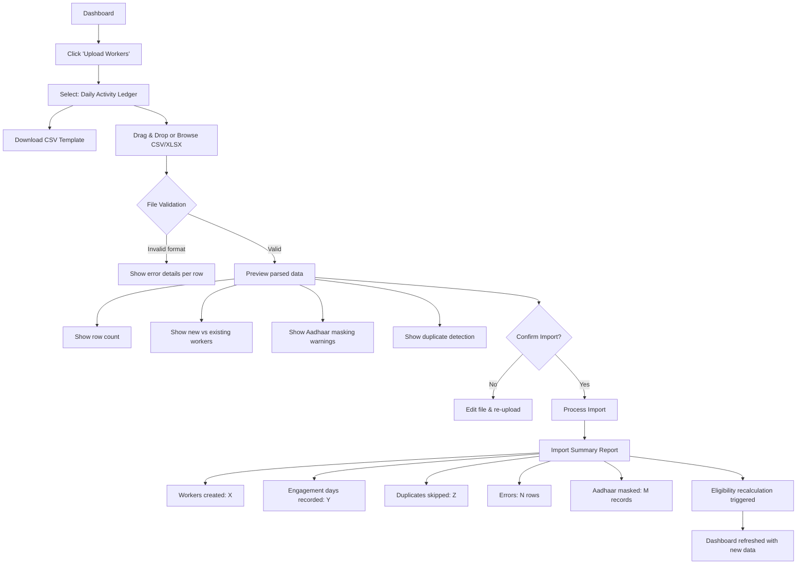

**Aadhaar Masking Flow (within validation):**
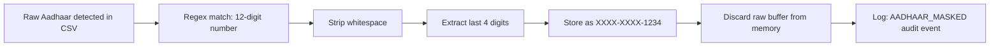

**CSV Column Mapping:**
| Expected Header | Aliases Accepted | Required |
|---|---|---|
| `worker_id` | `worker_code`, `driver_id`, `id` | ✅ |
| `worker_name` | `name`, `full_name`, `driver_name` | ❌ |
| `uan` | `eshram_uan`, `universal_account` | ❌ |
| `aadhaar_number` | `aadhaar`, `aadhar` | ❌ |
| `date` | `activity_date`, `engagement_date`, `work_date` | ✅ |
| `earnings` | `gross_earnings`, `amount`, `payout` | ✅ |
| `reference_id` | `trip_id`, `task_id`, `order_id` | ❌ |

**Error Handling:**
- Invalid dates: Show row number, value, and expected format.
- Missing required fields: Block import with clear instructions.
- Negative earnings: Warn but allow (could be adjustment/reversal).
- Duplicate entries (same worker + date + reference): Skip with warning.

---

## Flow 3 — Worker Roster Upload (Historical Backfill)

**Persona:** Ops Lead  
**Entry Point:** Dashboard → "Upload Workers" → "Historical Summary"

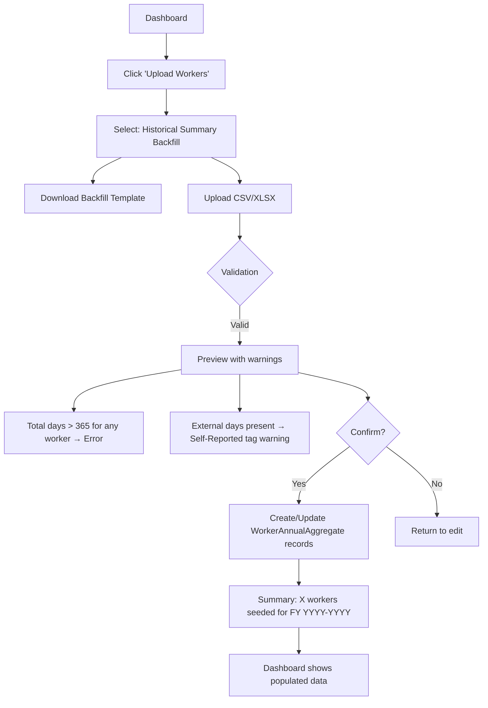

**Important Distinctions from Daily Ledger:**
- No individual engagement day entries are created — only aggregate records.
- Declared external days are tagged with `SELF_REPORTED_WORKER_DECLARATION` provenance.
- This mode is intended for rapid initial onboarding only; ongoing tracking should use the Daily Ledger.

---

## Flow 4 — Eligibility Dashboard & Day-Count Monitoring

**Persona:** Ops Lead  
**Entry Point:** Main dashboard (default view)

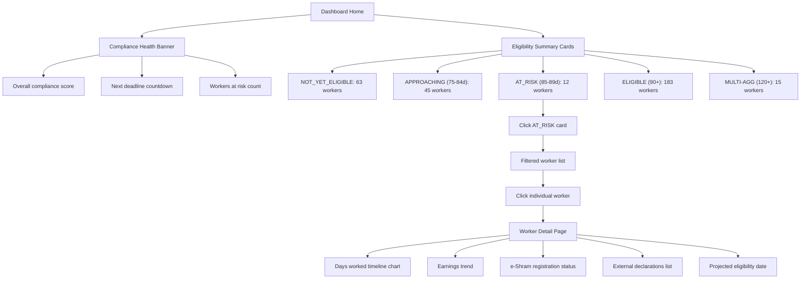

**Dashboard Components:**

| Component | Data Shown | Update Frequency |
|---|---|---|
| **Compliance Health Banner** | Overall score, next deadline, penalty exposure | Real-time on page load |
| **Eligibility Summary Cards** | Worker counts by status tier | After each upload or daily cron |
| **At-Risk Workers Table** | Workers within 5 days of 90-day threshold | After each upload or daily cron |
| **Registration Gap Alert** | Workers missing UAN or flagged | After each upload |
| **Filing Status Timeline** | Form-XX/XXI progress tracker | On filing status change |
| **Deadline Countdown** | Days/hours until next statutory due date | Real-time |

---

## Flow 5 — Worker Self-Declaration (Cross-Platform Days)

**Persona:** Ops Lead (on behalf of worker)  
**Entry Point:** Worker Detail Page → "Add External Platform Days"

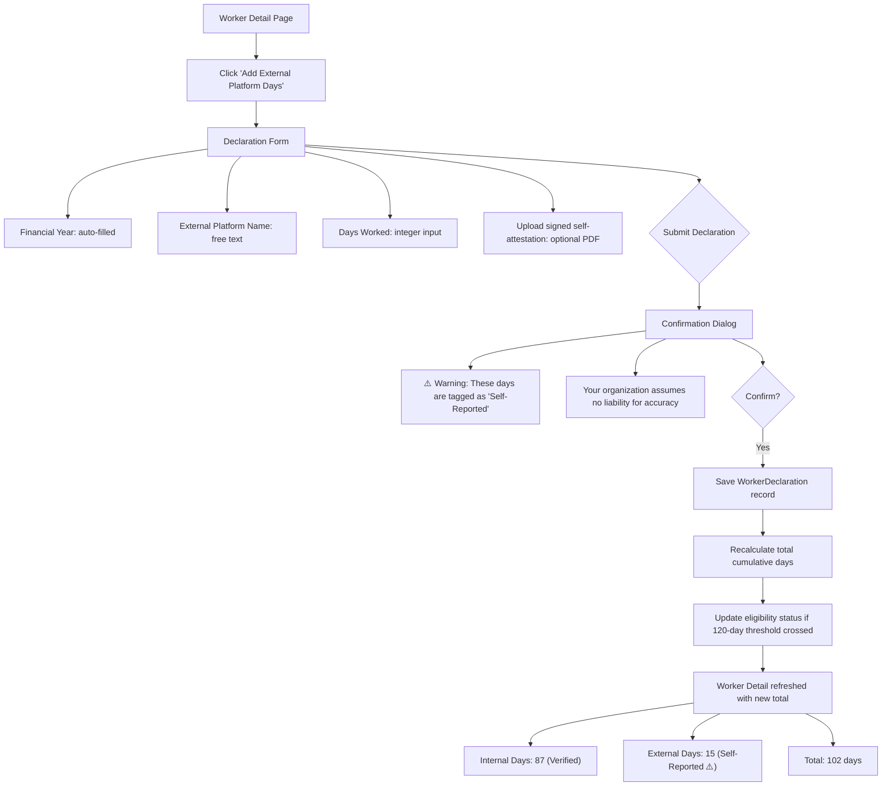

**Provenance Display Rules:**
- Internal days: Always shown with ✅ "Verified" badge.
- External declared days: Always shown with ⚠️ "Self-Reported" badge.
- Audit exports and PDFs include the full provenance label: `"SELF_REPORTED_WORKER_DECLARATION"`.

---

## Flow 6 — Form-XX Provisional Filing Wizard

**Persona:** Finance Lead / Ops Lead  
**Entry Point:** Filing Calendar → "Prepare Form-XX" or Deadline Alert CTA

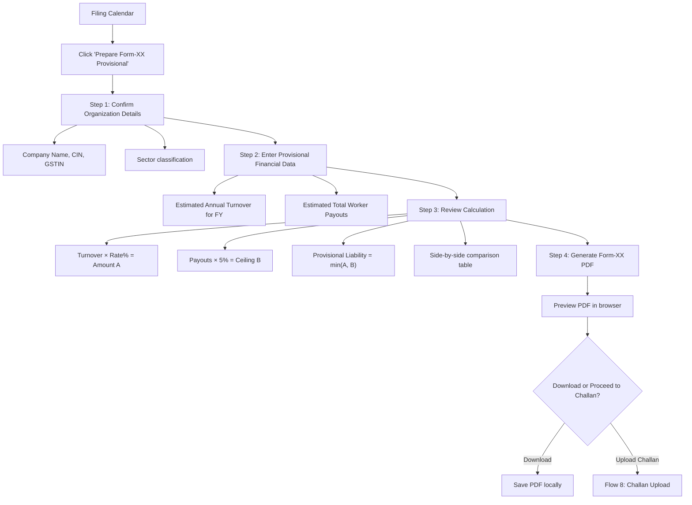

**Wizard Step Indicators:**
```
[1. Company Info] → [2. Financial Data] → [3. Review Calculation] → [4. Generate PDF] → [5. Upload Challan]
         ✅                  ✅                    🔵 Current              ⚪                    ⚪
```

---

## Flow 7 — Form-XXI Final Return Filing Wizard

**Persona:** Finance Lead / Ops Lead  
**Entry Point:** Filing Calendar → "Prepare Form-XXI" or Deadline Alert CTA

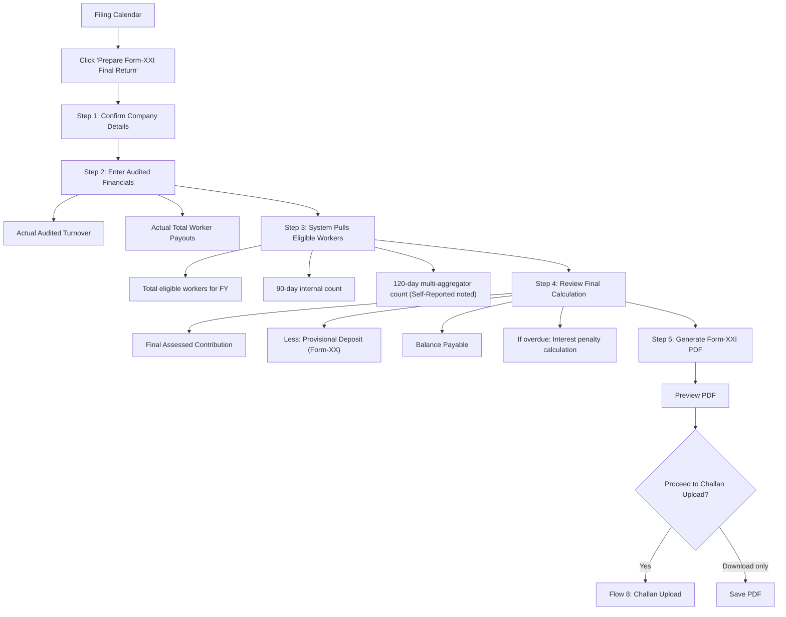

**Late Filing Warning:**
If the current date is past 31 October, the wizard displays:
```
⚠️ OVERDUE FILING
This return was due on 31 October 2026.
You are [X] months overdue.
Accrued interest penalty: ₹[amount] (1% per month on balance of ₹[balance])
Section 133 / Rule 49 applies.
```

---

## Flow 8 — Challan Upload & Audit Lock

**Persona:** Finance Lead  
**Entry Point:** Filing Wizard Step 5 or Filing Detail Page

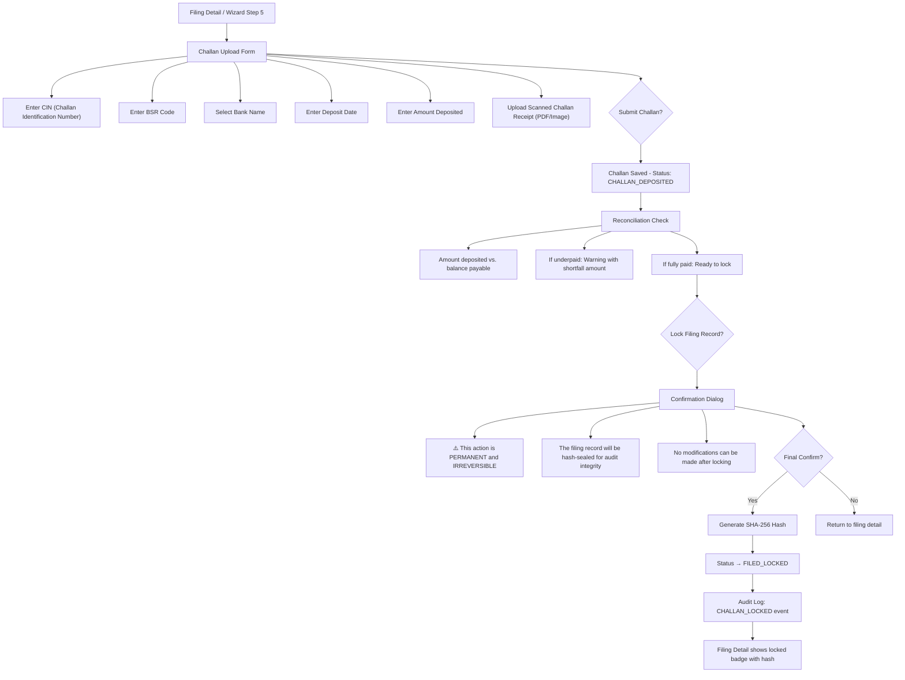

**Post-Lock Display:**
```
✅ FILED & LOCKED
Form-XXI Final Return — FY 2025-2026
Filed on: 28 October 2026 at 14:30 IST
Integrity Hash (SHA-256): a1b2c3d4e5f6...
This record is permanently sealed and cannot be modified.
```

---

## Flow 9 — Free Compliance Audit (Lead-Gen Funnel)

**Persona:** First-time Visitor / Prospective Customer  
**Entry Point:** Landing page → "Free Compliance Check" CTA

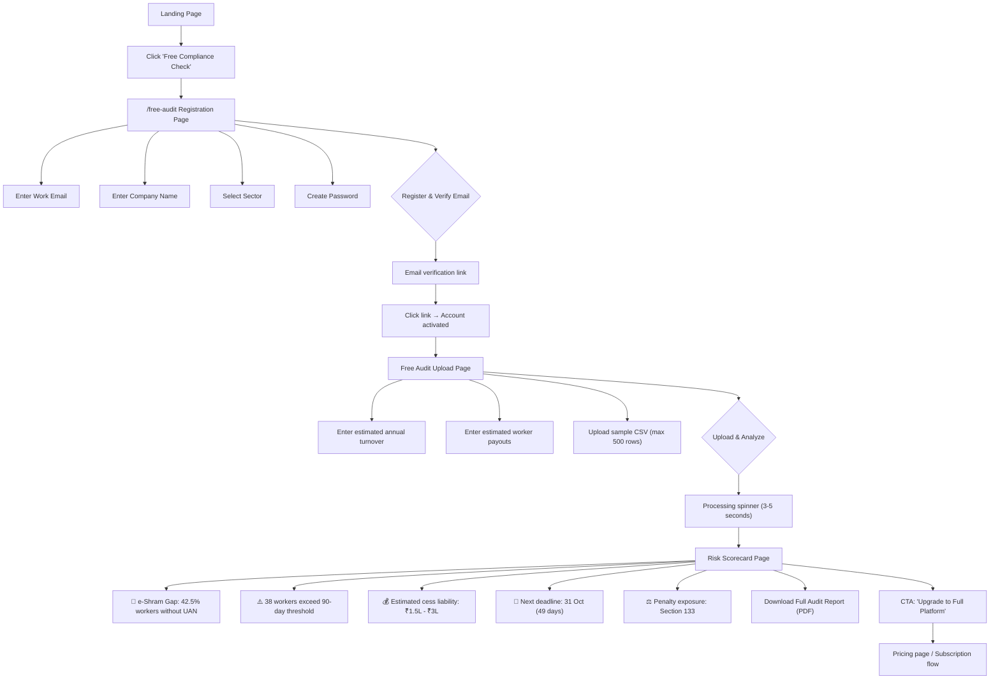

**Conversion Funnel Tracking:**
| Step | Event Name | Tracked Metric |
|---|---|---|
| Landing page visit | `funnel_landing_view` | Total visitors |
| Click "Free Check" | `funnel_cta_click` | Click-through rate |
| Registration submitted | `funnel_registration` | Registration rate |
| Email verified | `funnel_email_verified` | Verification rate |
| CSV uploaded | `funnel_csv_uploaded` | Upload completion |
| Scorecard viewed | `funnel_scorecard_view` | Scorecard delivery |
| Report downloaded | `funnel_report_download` | Report engagement |
| Upgrade clicked | `funnel_upgrade_click` | Conversion intent |
| Payment completed | `funnel_payment_complete` | Paid conversion |

---

## Flow 10 — Law Firm Partner Portal

**Persona:** Employment Law Firm / Compliance Advisory  
**Entry Point:** Partner login → Multi-client dashboard

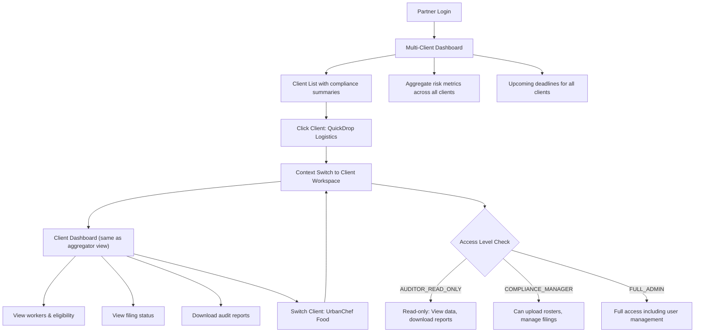

**Partner Dashboard Components:**
1. **Client Health Grid** — Traffic-light status for each client (🟢 Compliant, 🟡 Action Needed, 🔴 Overdue).
2. **Upcoming Deadlines Panel** — All client deadlines in a unified calendar view.
3. **Aggregate Statistics** — Total workers managed, total filings pending, overall gap count.
4. **Quick Actions** — Download bulk reports, send client reminders.

**Access Grant Flow (from Aggregator side):**
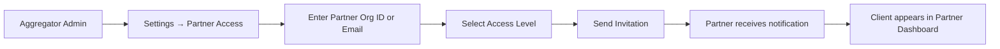

---

## Flow 11 — Compliance Audit Export

**Persona:** Ops Lead / Finance Lead / External Advisor  
**Entry Point:** Dashboard → "Export Reports" or Filing Detail → "Download Audit Package"

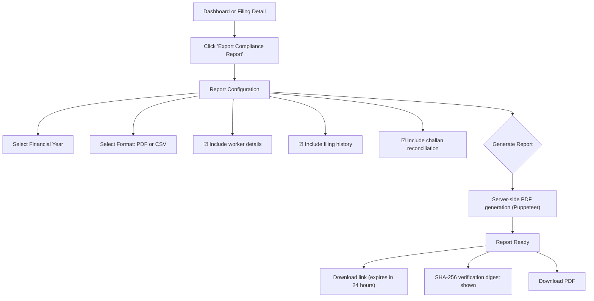

**Report Sections (PDF):**
1. **Cover Page** — Company name, CIN, GSTIN, report period, generation timestamp.
2. **Executive Summary** — Total workforce, eligible count, registration compliance rate, filing status.
3. **Worker Roster** — Full table with internal code, UAN, masked Aadhaar, days worked, eligibility status, registration status.
4. **Eligibility Analysis** — 90-day and 120-day breakdown with self-reported provenance callouts.
5. **Contribution Calculation** — Turnover basis vs. worker payment basis with ceiling application.
6. **Filing History** — All Form-XX/XXI records with dates, amounts, and statuses.
7. **Challan Reconciliation** — CIN, BSR code, bank, amounts, and receipts.
8. **Cryptographic Seal** — SHA-256 hash for document integrity verification.

---

## Flow 12 — Deadline Alert Lifecycle

**Persona:** System → Ops Lead / Finance Lead  
**Trigger:** Daily cron job at 00:30 IST

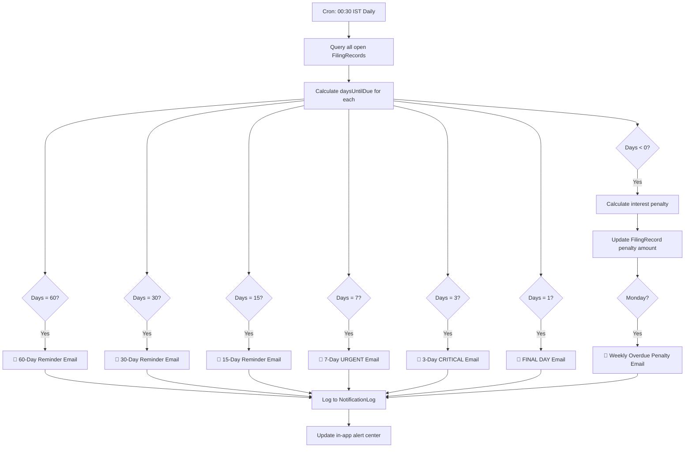

**Email Content Template (Example: 7-Day Alert):**
```
Subject: ⚠️ 7 DAYS — Form-XXI Final Return Due 31 October 2026

Dear Rajesh,

Your Form-XXI final annual return for FY 2025-2026 is due in 7 days.

📊 Current Status:
- Eligible workers: 198
- Balance payable: ₹1,00,000
- Filing status: IN_PROGRESS

⚠️ If missed, late filing attracts 1% monthly interest (₹1,000/month)
   under Section 133 / Rule 49 of the Social Security (Central) Rules, 2026.

👉 Complete your filing now: [Dashboard Link]

— GigCessHQ Compliance Platform
```

---

## Flow 13 — Team Member Invitation

**Persona:** Org Admin  
**Entry Point:** Settings → Team Management → "Invite Member"

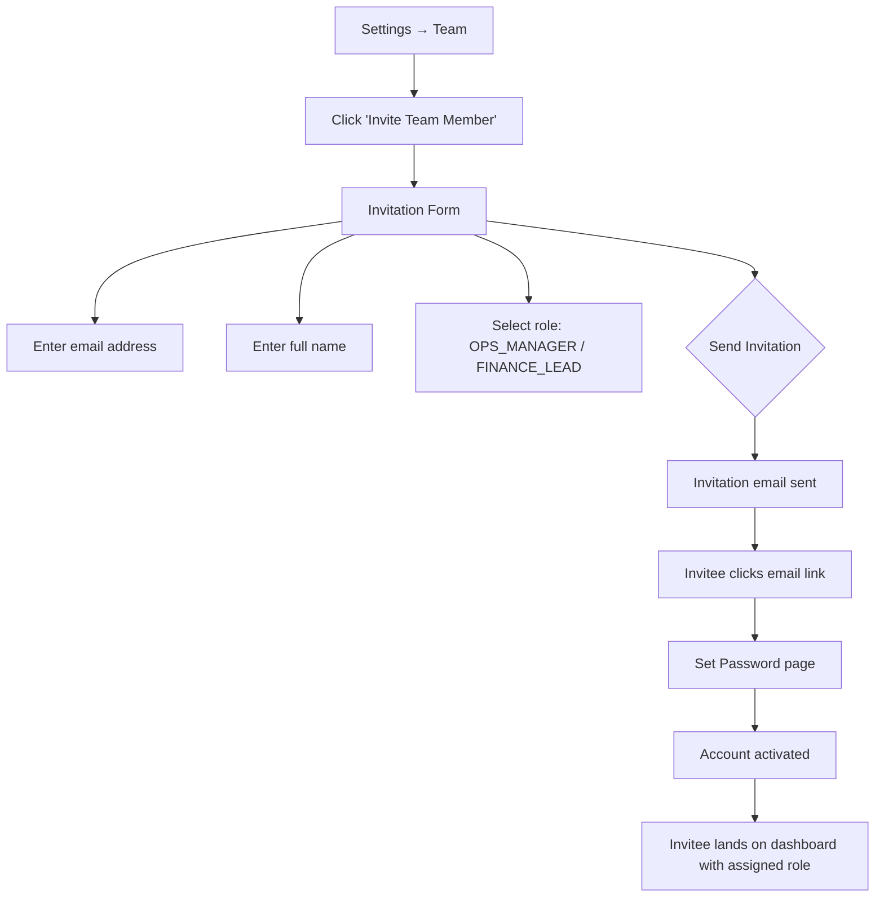

**Role Permissions Matrix:**

| Action | ORG_ADMIN | OPS_MANAGER | FINANCE_LEAD | EXTERNAL_ADVISOR |
|---|---|---|---|---|
| View dashboard & workers | ✅ | ✅ | ✅ | ✅ |
| Upload worker rosters | ✅ | ✅ | ❌ | Per access level |
| Manage worker records | ✅ | ✅ | ❌ | Per access level |
| View financial data | ✅ | ❌ | ✅ | Per access level |
| Create/manage filings | ✅ | ❌ | ✅ | Per access level |
| Upload challans | ✅ | ❌ | ✅ | ❌ |
| Lock filing records | ✅ | ❌ | ✅ | ❌ |
| Export audit reports | ✅ | ✅ | ✅ | ✅ |
| Manage team members | ✅ | ❌ | ❌ | ❌ |
| Grant partner access | ✅ | ❌ | ❌ | ❌ |
| View audit logs | ✅ | ❌ | ❌ | ❌ |
| Configure org settings | ✅ | ❌ | ❌ | ❌ |

---

## Flow 14 — Contribution Calculation & Comparison

**Persona:** Finance Lead / Ops Lead  
**Entry Point:** Dashboard → "Calculate Contribution" or Filing Wizard Step 3

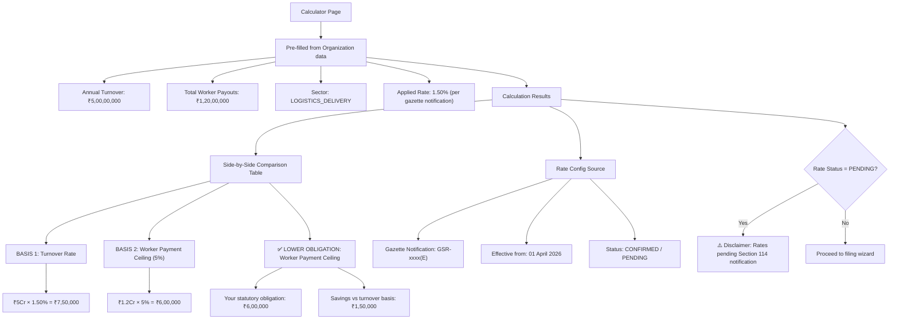

**Comparison Table Display:**
```
┌─────────────────────────────────┬──────────────────┬──────────────────┐
│                                 │  Turnover Basis   │  5% Payout Cap   │
├─────────────────────────────────┼──────────────────┼──────────────────┤
│ Base Amount                     │  ₹5,00,00,000    │  ₹1,20,00,000   │
│ Applied Rate                    │  1.50%            │  5.00%           │
│ Calculated Contribution         │  ₹7,50,000       │  ₹6,00,000      │
├─────────────────────────────────┼──────────────────┼──────────────────┤
│ YOUR OBLIGATION                 │                  │  ✅ ₹6,00,000   │
│ Savings                         │                  │  ₹1,50,000      │
└─────────────────────────────────┴──────────────────┴──────────────────┘
```
